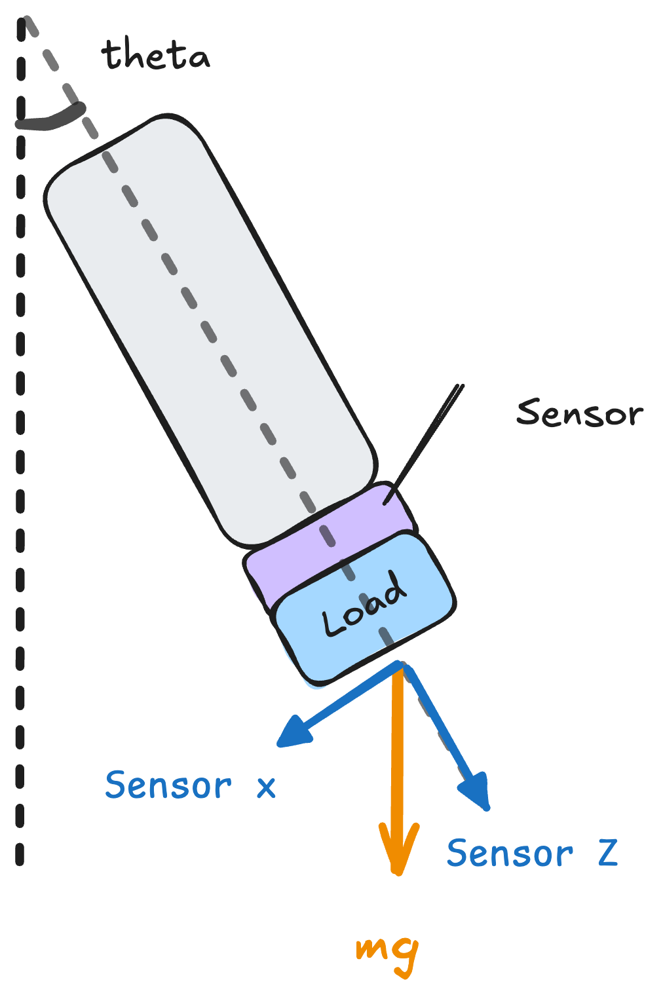
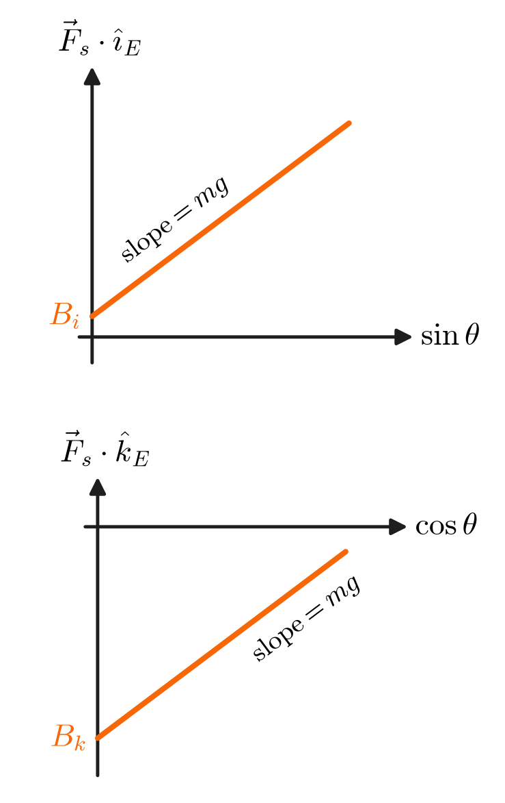
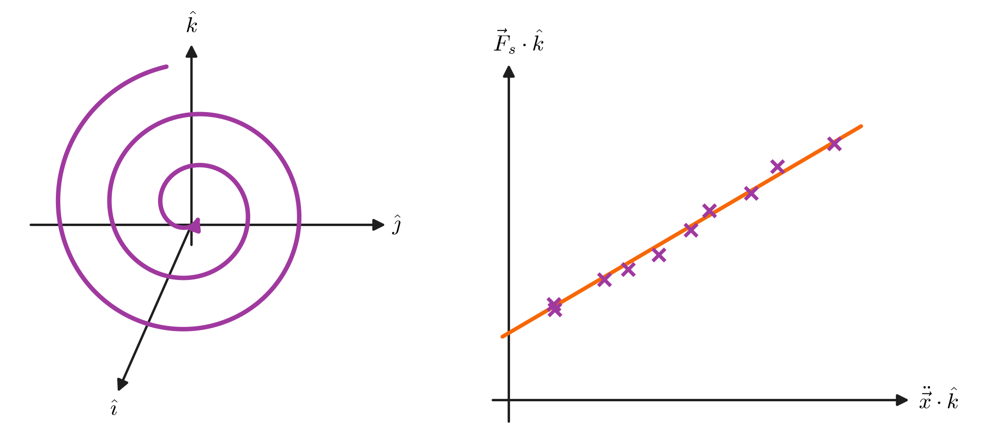

## 1. Defining the Problem

![[ForceFeedback.png]]

During tele-op, end effector tracks the desired position that the operator specifies through a controller. Our problem is: how to meaningfully reflect the measured force measured back to operator? 

We define action space in 3D world, every vector and matrix below has:
$$ \vec{v} \in \mathbb{R}^3 \quad\quad [A]\in\mathbb{R}^{3\times3} $$
We only consider translational force feedback, torque is similar. 

### 1.1 Controller Space and Robot Space

The controller polls the current position of the pen $\vec{p}$ in the controller space, we map it to the reference point in robot space through a linear function. The function is reversible.
$$ M(\vec{p})=s[R]\vec{p} + \vec{r}_0 = \vec{r} \quad\quad M^{-1}(\vec{r})=\vec{p} $$
where $s$ is the scaling factor, $[R]$ is the rotation from controller space to robot space, and $\vec{r}_0$ is the zero-reference. In real life, it gets reset every time the operator picks-up control again. Here, since the pilot remains control, we treat it as a constant.

Let the actual (measured) state of the robot be:  
$$\{\, \text{Position: } \,\vec{x} \quad\quad \text{Velocity: } \,\dot{\vec{x}} \quad\quad \text{Acceleration: } \,\ddot{\vec{x}} \,\}$$

### 1.2 Applied and Measured Force

The operator's hand applies a force $\vec{F}_o$ to the Haply controller.
The controller renders the feedback force $\vec{F}_b$ back onto the operator's hand.
$$ \vec{F_o} = - \vec{F_b} $$

On the robot side, we measure the raw force $\vec{F}_s$, and denote its filtered version as $\vec{F}_s^\ast$.
The raw reading is not yet the contact force $\vec{F}_c$ that the environment exerts on the end-effector: it also includes the inertia and weight of the end-effector, which has mass $m$:
$$ \vec{F}_s = \vec{F}_c - m\ddot{\vec{x}} - mg\,\hat{k} $$

Here $g$ is the gravitational acceleration and $\hat{k}$ is the upward unit vector.

Let $\hat{n}$ be the direction of the end-effector head.
The contact force splits into the normal force $\vec{F}_n$ along $\hat{n}$, and the friction $\vec{f}$ perpendicular to it:
$$ \vec{F}_n = \text{proj}_{\hat{n}}\,\vec{F}_c \quad\quad \vec{f} = \vec{F}_c - \vec{F}_n $$

## 2. Baseline Method

The baseline feeds back a blend of two $z$-axis forces, scaled by the gain $\lambda$:
$$ F_{b,z} = \lambda\,\big[(1-\alpha)\,F^\ast_{s,z} + \alpha\,F_{\text{wall},z}\big] $$
- **Direct force feedback:** the filtered force $F^\ast_{s,z}$.
- **Virtual wall with deadzone:** once $F_{s,z}$ exceeds a threshold, a wall is fixed at $p_\text{wall} = p_z + F^\ast_{s,z}/K$ and pushes back with $F_{\text{wall},z} = K\,(p_\text{wall} - p_z) - B\,\dot{p}_z$; below the threshold, $\alpha = 0$.

## 3. Admittance Controller

### 3.1 Purpose 

We want to control the amount of force applied on the object by the end-effector. 

However, we don't have the ability to control force precisely: motor torque control is open-loop; UR robots doesn't support it anyways. We only have a strong position controller that rigorously follows the reference, even when that means smashing hard into obstacles.

### 3.2 Modeling

The solution is we simulate a classic **impedance control model**. The operator holds the tool from a spring of *neglect-able length*.
- The hand represents reference pose $\vec{r}$, the tool represents end-effector position $\vec{x}$, the spring has impedance $K_p$.
- The spring has some damping factor too.
- The object exerts a force $\vec{F}_\text{ext}$ to the tool, and we wish to apply an additional $\vec{F}_\text{ref}$ onto the object.

![[Impedance Model.png]]

We can write differential equation:
$$ m_\text{vir} \,\ddot{\vec{x}} = \underbrace{K_p (\vec{r}-\vec{x})}_{\text{Impedance}} \,-\, \underbrace{K_d \dot{\vec{x}}}_{\text{Damping}} \,+\, \underbrace{(f_\text{ext} + f_\text{ref})^{*}}_{\text{Force Term}} $$

And we send the result of this simulation to the rigorous position controller instead.

### 3.3 Feedback

Now we ask in this model, what is the force that the tool feeds back on the operator? It turns out to be exactly equal to the force of the spring. This writes as a simple PD controller. 
$$ \vec{F}_b = K_p(\vec{x}-\vec{r}) - K_d \,\dot{\vec{r}} $$
Even better, this system 
## 4. Async Feedback System

<!-- TODO: Convert the Mermaid below to Excalidraw and embed as ![[Async Feedback System|100%]] -->

## 5. Sensor Calibration

To isolate the contact force $\vec{F}_c$, we need to estimate $m$ and $g$.
The sensor cannot be zeroed, so we apply linear system identification instead.

### 5.1 Tilting the Arm

  

    
  

  

    
  

With the load hanging below the sensor, rotate the arm upwards so that the head direction $\hat{n}$ tilts by $\theta$ from the vertical.
In the end-effector frame $(\hat{i}_E, \hat{k}_E)$, the sensor reads:
$$
\begin{cases}
\vec{F}_s \cdot \hat{k}_E = mg\cos\theta + B_k \\
\vec{F}_s \cdot \hat{i}_E = mg\sin\theta + B_i
\end{cases}
$$
Plot each component against $\cos\theta$ and $\sin\theta$: the slope yields the value of $mg$, and the intercepts give the biases $B_k$ and $B_i$.

### 5.2 Spiral Trajectory

Move the end-effector along a spiral in the vertical $\hat{j}$–$\hat{k}$ plane.
Plot $\vec{F}_s \cdot \hat{k}$ against $\ddot{\vec{x}} \cdot \hat{k}$, and fit a line through the samples.

