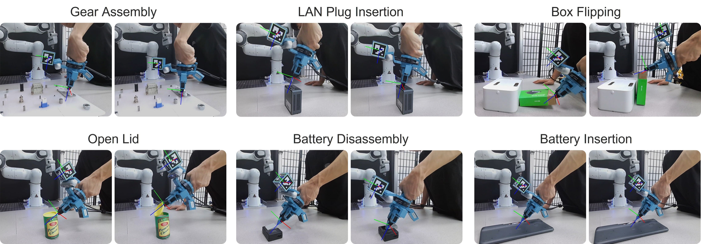
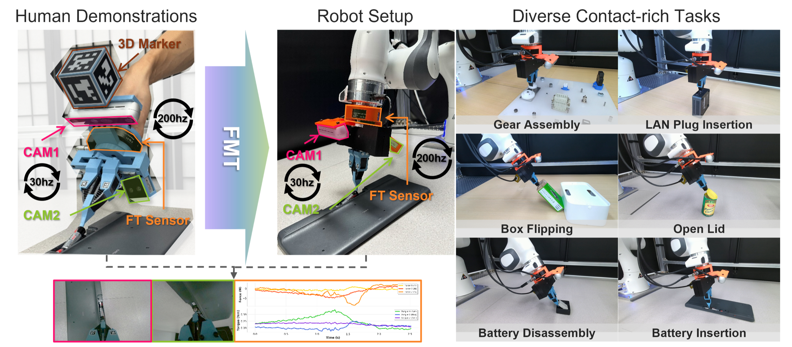
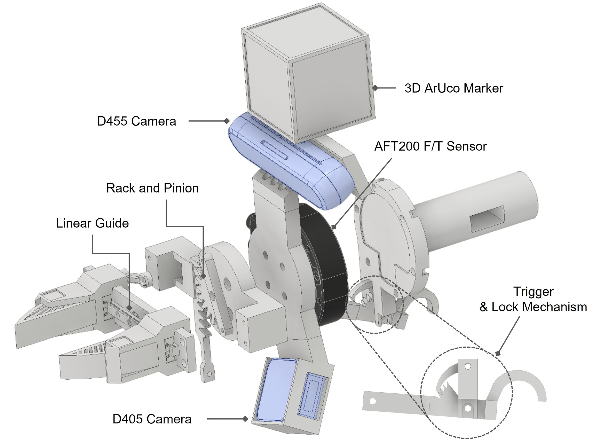
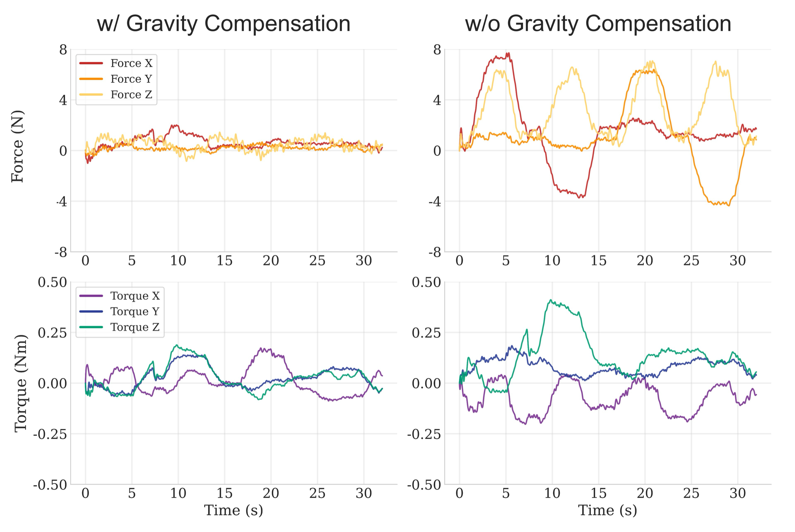
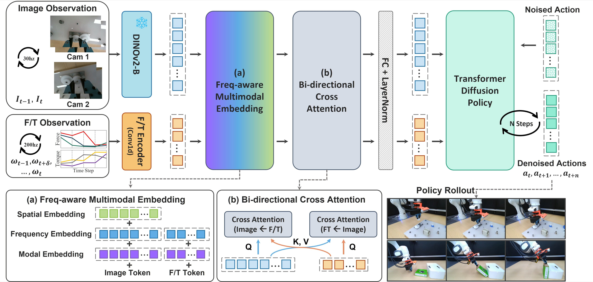
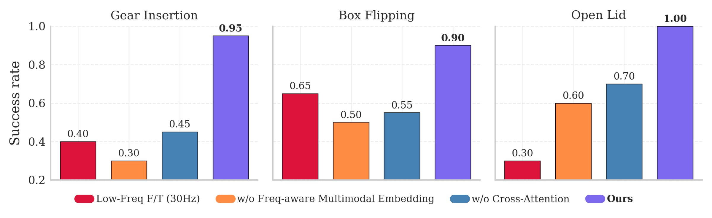
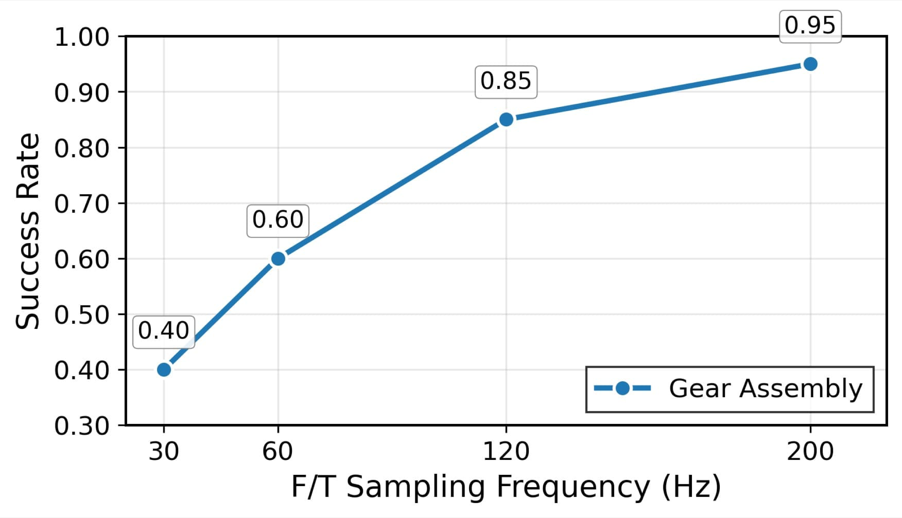
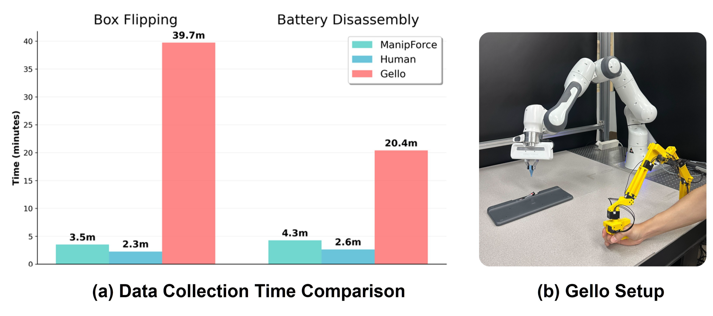
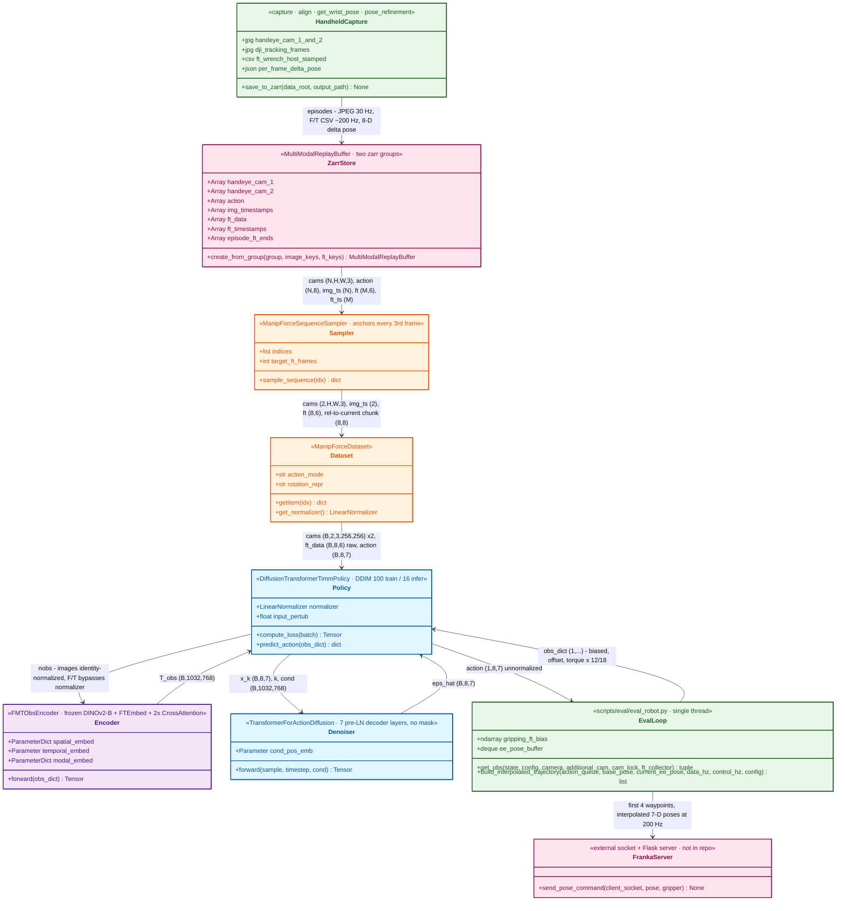

# ManipForce — Force-Guided Policy Learning with Frequency-Aware Representation

> arXiv: [2509.19047](https://arxiv.org/abs/2509.19047) · Geonhyup L. et al. · ICRA 2026 · 2025-09-23
> [Project](https://sites.google.com/view/manipforce/%ED%99%88) · [Code](https://github.com/gist-ailab/ManipForce) · Source: [Paper.md](sources/ManipForce/Paper.md) · [PDF](sources/ManipForce.pdf)

> [!abstract] TL;DR
> ## UMI-style handheld + wrist F/T → token-level visuo-force fusion inside a transformer DP

ManipForce is a handheld gripper in the [UMI](https://umi-gripper.github.io/) mould with two wrist RGB cameras plus a wrist F/T sensor (AIDIN AFT200, 200 Hz).
SLAM is replaced by an external Azure Kinect tracking a 3D ArUco cube, and the tool weight is removed with the D455 IMU so handheld and robot F/T readings are comparable.
FMT tokenizes frozen DINOv2-B patches and 1D-conv F/T samples, windowed between the two observed image timestamps rather than downsampled to the image rate.
It adds learnable spatial, "frequency" and modality embeddings, fuses the streams with one bidirectional cross-attention layer, and uses the result as the cross-attention memory of a [Diffusion Policy](https://diffusion-policy.cs.columbia.edu/) transformer.
On six Franka tasks (20 trials each), FMT averages **83 %** success vs **22 %** for an RGB-only DP with the same DINOv2-B backbone.
Caveats: the RGB-only DP is the only baseline, the ablations cover 3 of 6 tasks, and the released code differs from the paper in several reproduction-relevant ways (see [[#Codebase Status and Structure|Codebase]]).

---

> [!fact] Methodology
> ## Handheld RGB–F/T capture → frequency-aware tokens → transformer DP

**Overview.** The two-part system is (1) the ManipForce rig and (2) the FMT policy.
The rig has a D455 + D405 wrist-camera pair (30 Hz) and an AFT200 F/T sensor (200 Hz) with every gripper part mounted downstream of it.
Wrist pose comes from an externally tracked 3D ArUco cube, jaw state from jaw markers, and tool gravity is compensated with the D455 IMU; the same sensor and camera geometry is replicated on a Franka Panda.
FMT encodes $2$ cameras × $T_{\mathrm{img}}=2$ frames × $L=256$ DINOv2-B patches plus $T_{\mathrm{ft}}=8$ windowed F/T samples.
It adds spatial / frequency / modality embeddings, exchanges information through parallel image←F/T and F/T←image cross-attention, and passes $\mathbf{T}_{\mathrm{obs}}$ as conditioning to a transformer diffusion head that outputs an end-effector pose-delta chunk.

#### <u>1. Problem scope: six contact-rich tasks</u>

<div align="center"></div>

| Task | Contact signature (as characterised by the authors) |
| :--- | :--- |
| Gear Assembly | Rotational alignment under axial force; repeated jamming |
| LAN Plug Insertion | Sub-millimetre alignment, regulated insertion force |
| Box Flipping | Non-prehensile push-and-roll; sustained quasi-static contact |
| Open Lid | Single transient force spike on a small handle |
| Battery Disassembly | Tool inserted into a narrow gap, then lift |
| Battery Insertion | Spring-loaded battery; force direction must prevent ejection |


#### <u>2. ManipForce handheld system</u>

<div align="center"></div>

<div align="center"></div>

| Component | Hardware | Rate | Role |
| :--- | :--- | :--- | :--- |
| Hand-eye camera 1 | Intel RealSense D455 (+ IMU) | 30 Hz | Wide view; IMU gravity vector for F/T compensation |
| Hand-eye camera 2 | Intel RealSense D405 | 30 Hz | Close-range view of the jaws |
| Wrench | AIDIN AFT200 | 200 Hz | All gripper parts mounted downstream of the sensor |
| Wrist pose | 3D ArUco cube tracked by an external Azure Kinect (released code: a DJI Action camera) | 30 Hz | Replaces UMI's SLAM |
| Jaw state | ArUco markers on both jaws | 30 Hz | Open/close inferred from marker velocity |
| Gripper | Trigger-driven rack-and-pinion, linear guides, pin-ray fingertips, trigger lock | — | Lock holds the grasp so the wrench reflects contact, not grip effort |


#### <u>3. Wrist pose and action labels</u>

The paper states this step only in prose; the equations below restate that description in symbols.

| Symbol | ${}^{W}\mathbf{T}_{\mathrm{m},t}$ | ${}^{\mathrm{m}}\mathbf{T}_{\mathrm{tcp}}$ | ${}^{W}\mathbf{T}_{\mathrm{tcp},t}$ | $\Delta\mathbf{T}_t$ |
| :--- | :--- | :--- | :--- | :--- |
| Meaning | Cube-marker pose in the Kinect/world frame at frame $t$ | CAD-derived marker → TCP transform | TCP pose | 6-DoF pose delta between consecutive 30 Hz frames |

**Marker → TCP**

$$
{}^{W}\mathbf{T}_{\mathrm{tcp},t}={}^{W}\mathbf{T}_{\mathrm{m},t}\,{}^{\mathrm{m}}\mathbf{T}_{\mathrm{tcp}}
$$


**Per-frame action label**

$$
\Delta\mathbf{T}_t=\left({}^{W}\mathbf{T}_{\mathrm{tcp},t}\right)^{-1}{}^{W}\mathbf{T}_{\mathrm{tcp},t+1}
$$


#### <u>4. Tool gravity compensation</u>

| Symbol | $\mathbf{g}_{imu}$ | $R^{ft}_{imu}$ | $\mathbf{g}_{ft}$ | $m_{tool}$ | $\mathbf{r}_{com}$ | $\mathbf{F}_{g},\boldsymbol{\tau}_{g}$ | $\mathbf{F}_{measure},\boldsymbol{\tau}_{measure}$ | $\mathbf{F}_{comp},\boldsymbol{\tau}_{comp}$ |
| :--- | :--- | :--- | :--- | :--- | :--- | :--- | :--- | :--- |
| Meaning | Gravity vector from the D455 IMU | IMU → F/T-sensor rotation | Gravity in the sensor frame | Mass downstream of the sensor | Tool COM in the sensor frame | Gravitational wrench | Raw sensor wrench | Contact wrench fed to the policy |

**Gravity in the sensor frame**

$$
\mathbf{g}_{ft}=R^{ft}_{imu}\,\mathbf{g}_{imu}
$$


**Gravitational wrench**

$$
\mathbf{F}_{g}=m_{tool}\,\mathbf{g}_{ft}
$$


$$
\boldsymbol{\tau}_{g}=\mathbf{r}_{com}\times\mathbf{F}_{g}
$$


**Compensated wrench** (applied identically on the handheld rig and on the robot)

$$
\mathbf{F}_{comp}=\mathbf{F}_{measure}-\mathbf{F}_{g}
$$


$$
\boldsymbol{\tau}_{comp}=\boldsymbol{\tau}_{measure}-\boldsymbol{\tau}_{g}
$$

<div align="center"></div>

Related: the tilt-based F/T calibration in [[Force Feedback#5. Sensor Calibration]].


#### <u>5. FMT architecture</u>

<div align="center"></div>

##### 5.1 RGB–force tokenization

| Symbol | $\mathbf{T}_{\mathrm{cam1}},\mathbf{T}_{\mathrm{cam2}}$ | $\mathbf{T}_{\mathrm{ft}}$ | $T_{\mathrm{img}}$ | $L$ | $d$ | $T_{\mathrm{ft}}$ | $\omega$ |
| :--- | :--- | :--- | :--- | :--- | :--- | :--- | :--- |
| Meaning | DINOv2-B patch tokens per camera | 1D-CNN F/T tokens | Image horizon $=2$ | Patches per image $=256$ | Model width $=768$ | F/T horizon $=8$ | One gravity-compensated wrench sample |

$$
\mathbf{T}_{\mathrm{cam1}},\mathbf{T}_{\mathrm{cam2}}\in\mathbb{R}^{T_{\mathrm{img}}\times L\times d}
$$


$$
\mathbf{T}_{\mathrm{ft}}\in\mathbb{R}^{T_{\mathrm{ft}}\times d}
$$


**Timestamp-based windowing.** The paper describes the window; the pad/decimate rule is taken from the released sampler.

```python
def window_ft(
    ft: ndarray,
    ft_ts: ndarray,
    img_ts: ndarray,
    t_ft: int = 8,
) -> ndarray:
    '''
    Keep the F/T samples stamped between the two observed image
    frames, then pad (repeat last) or decimate (uniform index)
    to exactly t_ft samples.
    ft:     (N, 6) gravity-compensated wrench stream
    ft_ts:  (N,) timestamps
    img_ts: (2,) timestamps of I_{t-1}, I_t
    returns (t_ft, 6)
    '''
    lo = searchsorted(ft_ts, img_ts[0], side="left")
    hi = searchsorted(ft_ts, img_ts[1], side="right")
    win = ft[lo:hi]
    if len(win) == 0:
        return zeros((t_ft, 6))
    if len(win) < t_ft:
        pad = repeat(win[-1:], t_ft - len(win), axis=0)
        return concatenate([win, pad])
    idx = linspace(0, len(win) - 1, t_ft).astype(int)
    return win[idx]
```


##### 5.2 Frequency-aware multimodal embedding

| Symbol | $\mathbf{E}_{\mathrm{spatial}}\in\mathbb{R}^{L\times d}$ | $\mathbf{E}_{\mathrm{freq}}\in\mathbb{R}^{T_{\mathrm{ft}}\times d}$ | $\operatorname{Interp}_{T_{\mathrm{ft}}\to T_{\mathrm{img}}}$ | $\mathbf{E}_{\mathrm{cam1}},\mathbf{E}_{\mathrm{cam2}},\mathbf{E}_{\mathrm{ft}}\in\mathbb{R}^{1\times d}$ | $\mathbf{T}'_{\mathrm{cam}}$ | $\mathbf{T}'_{\mathrm{ft}}$ |
| :--- | :--- | :--- | :--- | :--- | :--- | :--- |
| Meaning | Within-image patch position | Learnable timestamp embedding on the F/T grid | Linear resampling of $\mathbf{E}_{\mathrm{freq}}$ to the image horizon | Source-modality embedding | Unified visual tokens, $\mathbb{R}^{2LT_{\mathrm{img}}\times d}$ (written $\mathbf{T}'_{\mathrm{img}}$ in §5.3) | Unified F/T tokens, $\mathbb{R}^{T_{\mathrm{ft}}\times d}$ |

The paper says the three embeddings are "added" to the tokens; the sums below are that statement in symbols (broadcast over time / patches).

$$
\mathbf{T}'_{\mathrm{cam}k}=\mathbf{T}_{\mathrm{cam}k}+\mathbf{E}_{\mathrm{spatial}}+\operatorname{Interp}_{T_{\mathrm{ft}}\to T_{\mathrm{img}}}\!\left(\mathbf{E}_{\mathrm{freq}}\right)+\mathbf{E}_{\mathrm{cam}k},\qquad k\in\{1,2\}
$$


$$
\mathbf{T}'_{\mathrm{ft}}=\mathbf{T}_{\mathrm{ft}}+\mathbf{E}_{\mathrm{freq}}+\mathbf{E}_{\mathrm{ft}}
$$


$$
\mathbf{T}'_{\mathrm{cam}}=\operatorname{Cat}\!\left(\mathbf{T}'_{\mathrm{cam1}},\mathbf{T}'_{\mathrm{cam2}}\right)\in\mathbb{R}^{2LT_{\mathrm{img}}\times d}
$$


##### 5.3 Bidirectional cross-attention and fusion

| Symbol | $\operatorname{CA}_{a\leftarrow b}$ | $\mathbf{T}''_{\mathrm{img}}$ | $\mathbf{T}''_{\mathrm{ft}}$ | $\operatorname{FC}$ | $\operatorname{LN}$ | $\mathbf{T}_{\mathrm{obs}}$ |
| :--- | :--- | :--- | :--- | :--- | :--- | :--- |
| Meaning | Cross-attention, $\mathrm{Q}=\mathbf{X}_a$, $\mathrm{K}=\mathrm{V}=\mathbf{X}_b$ | Force-enhanced visual tokens | Vision-enhanced F/T tokens | Fully connected layer | Layer normalization | Conditioning tokens for the diffusion head |

**Image ← F/T**

$$
\mathbf{T}''_{\mathrm{img}}=\operatorname{CA}_{\mathrm{img}\leftarrow\mathrm{ft}}\!\left(\mathrm{Q}=\mathbf{T}'_{\mathrm{img}},\ \mathrm{K}=\mathbf{T}'_{\mathrm{ft}},\ \mathrm{V}=\mathbf{T}'_{\mathrm{ft}}\right)
$$


**F/T ← image**

$$
\mathbf{T}''_{\mathrm{ft}}=\operatorname{CA}_{\mathrm{ft}\leftarrow\mathrm{img}}\!\left(\mathrm{Q}=\mathbf{T}'_{\mathrm{ft}},\ \mathrm{K}=\mathbf{T}'_{\mathrm{img}},\ \mathrm{V}=\mathbf{T}'_{\mathrm{img}}\right)
$$


**Unified observation**

$$
\boxed{\mathbf{T}_{\mathrm{obs}}=\operatorname{LN}\!\left(\operatorname{FC}\!\left(\operatorname{Cat}\!\left(\mathbf{T}''_{\mathrm{img}},\,\mathbf{T}''_{\mathrm{ft}}\right)\right)\right)\in\mathbb{R}^{(2LT_{\mathrm{img}}+T_{\mathrm{ft}})\times d}}
$$


```python
def fmt_encode(
    cam1: Tensor,
    cam2: Tensor,
    ft: Tensor,
    enc: FMT,
) -> Tensor:
    '''
    cam1, cam2: (B, T_img, 3, 256, 256) square-padded RGB
    ft:         (B, T_ft, 6) windowed wrench samples
    returns T_obs: (B, 2 * T_img * L + T_ft, d) = (B, 1032, 768)
    '''
    # frozen DINOv2-B, CLS dropped -> (B, T_img, L, d)
    t1 = enc.img_proj(enc.dino(cam1))
    t2 = enc.img_proj(enc.dino(cam2))
    tf = enc.ft_proj(enc.ft_conv(ft))
    # E_freq lives on the F/T grid; resample it to T_img
    e_img = interp_linear(enc.e_freq, size=t1.shape[1])
    t1 = t1 + enc.e_spatial["cam1"] + e_img + enc.e_mod["cam1"]
    t2 = t2 + enc.e_spatial["cam2"] + e_img + enc.e_mod["cam2"]
    tf = tf + enc.e_freq + enc.e_mod["ft"]
    # per-modality LayerNorm (in the code, not in the paper)
    t1, t2, tf = enc.ln_img(t1), enc.ln_img(t2), enc.ln_ft(tf)
    img = cat([flatten_tl(t1), flatten_tl(t2)], dim=1)
    # parallel bidirectional cross-attention
    img2 = enc.ca_img_from_ft(q=img, kv=tf)
    tf2 = enc.ca_ft_from_img(q=tf, kv=img)
    return enc.ln(enc.fc(cat([img2, tf2], dim=1)))
```


##### 5.4 Transformer diffusion head

The head is DP's time-series diffusion transformer with ε-prediction, conditioned on $\mathbf{T}_{\mathrm{obs}}$ through cross-attention.
The paper describes it as "causal self-attention over previous action tokens"; the released denoiser applies no mask (see [[#Codebase Status and Structure|Codebase]]).


---

> [!info] Implementation Details
> ## Reproduction-critical settings

Source "paper" = stated in the TeX; "code" = `diffusion_policy/config/*` at commit [`f148964`](https://github.com/gist-ailab/ManipForce/tree/f1489642b95783312b867fe958ee7f266ca19288), which postdates the paper (see Codebase).

| Setting | Value | Source |
| :--- | :--- | :--- |
| Demonstrations / evaluation | ≈100 episodes per task / 20 trials, randomized robot and object poses | paper |
| Image preprocessing | Square-pad, resize to $256\times256$; RandomCrop 0.95 + ColorJitter(0.3, 0.4, 0.5, 0.08), applied in train *and* eval; no ImageNet normalization despite `imagenet_norm: True` | paper / code |
| Visual backbone | DINOv2-B, **frozen**; ViT-B/14 weights with the patch kernel bicubically resized 14 → 16 so that $L=16\times16$ | paper / code |
| Horizons | $T_{\mathrm{img}}=2$, $T_{\mathrm{ft}}=8$, action chunk $8$; observations and actions sub-sampled 3× from 30 Hz (`ods3`; an `ods2` config also ships) | paper / code |
| Fusion | $d=768$; one cross-attention layer per direction, 12 heads, post-norm + FFN | paper / code |
| Denoiser | 7 decoder layers, 8 heads, $n_{\mathrm{emb}}=768$, dropout 0.1 | code |
| Diffusion | DDIM, 100 train steps (`squaredcos_cap_v2`, ε-prediction), 16 inference steps; DDPM-IP input perturbation 0.1 | code |
| Optimisation | AdamW, lr $10^{-4}$ (all trainable encoder layers at $10^{-5}$), wd $10^{-6}$, β = (0.95, 0.999), batch 64, 500 epochs, cosine with 500 warm-up steps, EMA | code |
| Action | Pose of each future step relative to the current pose, axis-angle rotation + gripper (7-D) | code |
| Robot | Franka Panda, same AFT200 at the wrist, same gravity compensation, compliance controller; camera TCP-to-lens distances matched to the handheld rig | paper |


---

> [!hint] Experiments & Findings
> ## Large gains over RGB-only DP; thin evidence on what drives them

#### <u>Protocol</u>

| Item | Setting |
| :--- | :--- |
| Platform | Franka Panda + AFT200 + D455/D405 in handheld-matched geometry; compliance controller (gains not reported) |
| Data | ≈100 handheld demonstrations per task, no robot data |
| Trials | 20 per task per method; randomized initial robot and object poses (ranges not reported) |
| Baseline | **RGB-only** = DP transformer with ResNet-18 swapped for the same DINOv2-B, RGB tokens only |
| Seeds / variance | Not reported; no confidence intervals |

#### <u>Q1 — Does high-rate F/T help? (Table I)</u>

| Method | Gear Assembly | LAN Plug | Box Flipping | Open Lid | Battery Disassembly | Battery Insertion | Mean |
| :--- | ---: | ---: | ---: | ---: | ---: | ---: | ---: |
| RGB-only DP (DINOv2-B) | 0.35 | 0.40 | 0.05 | 0.20 | 0.20 | 0.10 | 0.22 |
| **FMT** | **0.95** | **0.85** | **0.90** | **1.00** | **0.65** | **0.60** | **0.83** |
| Δ (pp) | +60 | +45 | +85 | +80 | +45 | +50 | +61 |

Wilson 95 % intervals do not overlap on any task; the closest is battery disassembly, FMT 13/20 → [0.43, 0.82] vs 4/20 → [0.08, 0.42].
The two battery tasks remain the weakest (0.60–0.65).
The project page attributes the baseline's failures to a gear stuck on the shaft, unstable pressing, lost contact, and missing the battery slot.


#### <u>Q2 — Which FMT module matters? (Fig. 7, 3 tasks)</u>

<div align="center"></div>

| Removed → cost (pp vs full) | Gear | Box Flipping | Open Lid |
| :--- | ---: | ---: | ---: |
| 200 Hz → 30 Hz F/T | −55 | −25 | **−70** |
| Frequency + modality embeddings | **−65** | **−40** | −40 |
| Bidirectional cross-attention | −50 | −35 | −30 |
| *(RGB-only, from Q1, for reference)* | −60 | −85 | −80 |

- Each single removal costs 25–70 pp, leaving 0.30–0.70.
  The drops are far from additive: on Gear they sum to 170 pp against a 60 pp FMT-vs-RGB gap, so the modules interact rather than contribute independently.
- On Gear, F/T *without* the embeddings (0.30) is no better than no F/T at all (RGB-only 0.35).
- On Box Flipping, all F/T variants (0.50–0.65) remain far above RGB-only (0.05).
- The "Ours" bars equal Table I (0.95 / 0.90 / 1.00), so the full-model runs are shared with the main table.
- The text claims full-model superiority "across all six contact-rich tasks"; the figure contains three.


#### <u>Q3 — F/T sampling rate (Fig. 8, Gear Assembly only)</u>

<div align="center"></div>

Success rises monotonically: 0.40 → 0.60 → 0.85 → 0.95 at 30 / 60 / 120 / 200 Hz.
The 30 Hz point equals the Low-Freq ablation (0.40).
The 120 → 200 Hz step (17/20 vs 19/20) is inside sampling noise, with Wilson intervals [0.64, 0.95] vs [0.76, 0.99].
How the stream was sub-sampled for this sweep is not described; see the Codebase section for why the released windowing makes 60–200 Hz inputs nearly equivalent.


#### <u>Q4 — Collection efficiency (Fig. 9)</u>

<div align="center"></div>

| Task | ManipForce / human | Gello / ManipForce |
| :--- | ---: | ---: |
| Box Flipping | 1.52× | 11.3× |
| Battery Disassembly | 1.65× | 4.7× |

The number of demonstrations behind each bar is not stated, so these are relative timings only.
The teleoperation baseline is Gello (no haptic feedback); no comparison against haptic teleoperation is made.


#### <u>Limitations</u>

- **Authors' stated limitation:** none beyond future work on longer-horizon tasks and more dexterous gripper behaviour.
- **Review assessment — baseline scope:** the only policy baseline is RGB-only DP.
  The visuo-force methods discussed in related work are not compared: ForceMimic's concatenation, Reactive Diffusion Policy's dual-rate design, FoAR's contact gating and FACTR.
  The simplest DP-style alternative, F/T as a low-dimensional observation concatenated to the global condition, is also missing.
  The ablations only remove parts of FMT's own token pipeline.
- **Review assessment — ablation coverage:** module and frequency ablations use 3 and 1 of 6 tasks respectively, with one run per cell; the prose generalizes them to all tasks.
- **Review assessment — gravity compensation claim:** the text reports residuals "within ±1 N" and "within 0.15 N·m", but the compensated traces in Fig. 4 reach ≈2 N (Force X near t ≈ 10 s) and ≈0.19 N·m (Torque Z).
- **Review assessment — action space:** the policy outputs poses only; force regulation is delegated to a compliance controller whose gains are not reported (cf. [[Admittance Control Literature Review]]).
  Its effect on the Table I gap is uncontrolled.
- **Review assessment — "identical" embodiment:** the released eval code rescales torques by 12/18 to correct a moment-arm difference between the handheld rig and the Panda mount (Codebase).
  The two systems are therefore not geometrically identical, as the paper implies.
- **Review assessment — reproducibility:** "Hardware Materials (coming soon)" is still unreleased more than a year after the preprint; no datasets or checkpoints are released.


---

> [!fact] Reflection
> ## My Read


---

> [!hint] Codebase
> ## Codebase Status and Structure

**Verdict:** [`gist-ailab/ManipForce`](https://github.com/gist-ailab/ManipForce) is a fork of [UMI](https://github.com/real-stanford/universal_manipulation_interface)'s `diffusion_policy` package.
It adds about 8 policy-relevant files plus a hardware/eval layer.
It is a readable reference for FMT, not a reproduction package.
The snapshot was committed 4–7 months after the preprint, and it ships no data, checkpoints, per-task or baseline configs, robot server or hardware files.
It also deviates from the paper in sensing, F/T processing and action execution.

Reviewed at commit [`f148964`](https://github.com/gist-ailab/ManipForce/tree/f1489642b95783312b867fe958ee7f266ca19288) (2026-04-23), cloned to `~/Coding/ManipForce`; static review only, nothing executed.

| Aspect | Assessment |
| --- | --- |
| **Completeness** | FMT encoder, multi-rate sampler, training workspace and Franka eval loop are present; the RGB-only baseline, ablation and frequency-sweep configs, the robot server, datasets and checkpoints are absent. |
| **Adaptation** | README covers capture → zarr → train → eval in nine commands, but the hardware layer hard-codes camera serials and the F/T IP, and its comments are in Korean; 16 stars, 2 forks, 0 issues. |
| **Dependency** | UMI's `diffusion_policy` + a vendored DINOv2; robot side needs RealSense, an Aidin UDP F/T, `ahrs`, a SpaceMouse and an external Franka socket/Flask server, several of which `environment.yml` omits. |
| **Currency** | torch 2.1.0 + CUDA 11.8, numpy 1.23.5, Python 3.10; 29 commits from 2026-01-30 to 2026-04-23, inactive since. |

**Replication difficulty: Hard** for the paper's numbers: the data, checkpoints, hardware files, robot server and per-task configs are missing.
**Moderate** for training on your own zarr (conda env, DINOv2 weight conversion, one launch command).
Training is GPU-only, and the pinned torch 2.1/cu118 predates RTX 50-series support, so a Blackwell GPU needs a torch ≥ 2.7/cu128 bump.

### What changed relative to Diffusion Policy

Lineage: original DP → UMI → ManipForce.
The denoiser, normalizer, replay buffer and training scaffolding are UMI's, unchanged; the force path, fusion, data sampling and robot runtime are new.

| Part | Original DP | ManipForce |
| --- | --- | --- |
| Vision encoder | Trainable ResNet-18 per camera, pooled to one feature vector per camera per step | Frozen DINOv2-B; all 256 patch tokens kept per frame |
| Force input | None (any low-dim obs is normalized and concatenated) | 8 raw, unnormalized F/T samples per step, matched to images by timestamp, conv-embedded |
| Fusion | Concatenate per-camera vectors and low-dim state | Spatial / frequency / modality embeddings + one bidirectional cross-attention layer → 1032 tokens |
| Denoiser conditioning | Few obs tokens, time token first; causal action and memory masks | 1032 obs tokens + time token as cross-attention memory; no masks |
| Diffusion | DDPM / DDIM, ε-prediction | Same, plus DDPM-IP input perturbation; DDIM 16 steps |
| Proprioception | EE pose in the observation | Not used |
| Action | Absolute or delta EE pose at the native rate | 8 future poses relative to the current TCP, 100 ms apart, axis-angle |
| Data sampling | One rate, index-aligned, every frame | Two-rate store, F/T windowed by timestamp, every 3rd frame |
| Optimizer | Weight-decay groups; separate encoder LR | Two groups; the new fusion layers train at 0.1× LR |
| Robot runtime | Asynchronous controller with timestamped actions | Synchronous loop: infer → first 4 of 8 waypoints interpolated to 200 Hz → blocking sends |

Model size (analytic, from the config): denoiser ≈ 67 M parameters, fusion ≈ 16.4 M (of which cross-attention ≈ 14.2 M), frozen ViT-B ≈ 86 M.

> [!warning]- Paper ↔ code mismatches
> - **Tracker:** a DJI Action camera with a fixed 133 ms sync offset, not an Azure Kinect; the TCP offset is hard-coded.
> - **Denoiser:** no causal mask; the 8 action tokens attend bidirectionally.
> - **"1D CNN":** one $k=3$ conv branch, gated by a learnable $\alpha$ (init 0.01), on top of a linear projection of the raw wrench.
> - **"200 Hz F/T":** a 100 ms window is decimated to 8 samples (≈70 Hz) of a wrench low-passed at ≈20 Hz, so 60 / 120 / 200 Hz inputs are nearly identical.
> - **Frequency embedding:** index-based, not timestamp-based; the image frames get the means of slots 1–2 and 5–6 rather than the window endpoints 0 and 7.
> - **Gravity compensation:** per-axis masses (the $z$ term uses the $x$ mass) and a hard-coded IMU → F/T rotation; the constants differ between capture and eval.
> - **Post-paper changes:** the action representation changed after release, and the checkpoint loader patches older module names, so the paper's numbers came from an earlier codebase.

> [!info]- Undocumented tricks
> - **Per-episode F/T tare:** the mean of samples 5–100 is subtracted, both when building the dataset and after each eval reset.
> - **Eval offset:** a fixed "training-set mean" wrench is added back to the live F/T.
> - **Torque rescale:** robot torques are scaled by 12/18 to correct the handheld ↔ Panda moment-arm difference.
> - **Backbone surgery:** the DINOv2 patch kernel is resized from 14 to 16 px, and the backbone stays frozen.
> - **Fusion LR:** the "pretrained encoder" LR cut lands on the new fusion layers (10⁻⁵ vs 10⁻⁴).
> - **Sampling:** training samples start only every 3rd frame; DDPM-IP input perturbation is 0.1.

### Pipeline Breakdown

Four boundaries carry data:
- handheld episodes → zarr;
- sampler → batch, where multi-rate alignment happens;
- encoder → denoiser memory, the FMT contribution;
- action chunk → robot, where the runtime re-interprets frames and timing.

#### Data Flow Diagram

<!-- TODO: Convert the Mermaid below to Excalidraw and embed as ![[ManipForce Data Flow|100%]] -->



#### Layer-Boundary API Signatures

**1. Zarr → sample.** ([`sampler.py:346`](https://github.com/gist-ailab/ManipForce/blob/f1489642b95783312b867fe958ee7f266ca19288/diffusion_policy/common/sampler.py#L346))

```python
def sample_sequence(self, idx: int) -> dict[str, ndarray]:
    '''
    ManipForceSequenceSampler. Anchor = every 3rd raw frame.
    handeye_cam_k:  (T_img=2, H, W, 3) uint8, frames cur-3, cur
    img_timestamps: (2,) float64 'YYYYMMDDhhmmssmmm'
    ft_data:        (8, 6) samples with ts in [img_ts0, img_ts1],
                    last-frame padded or linspace-decimated
    ft_timestamps:  (8,)
    action:         (8, 8) rel_to_start: SE(3)-composed
                    per-frame deltas -> pose at cur + 3k,
                    k = 1..8, in the current TCP frame
                    [pos3, quat_xyzw4, grip1]
    '''
    ...
```

**2. Sample → training batch.** ([`manipforce_dataset.py:625`](https://github.com/gist-ailab/ManipForce/blob/f1489642b95783312b867fe958ee7f266ca19288/diffusion_policy/dataset/manipforce_dataset.py#L625))

```python
def __getitem__(self, idx: int) -> dict[str, dict | Tensor]:
    '''
    obs.handeye_cam_k:  (2, 3, 256, 256) float in [0, 1];
                        square-pad + resize per sample on CPU
                        if the zarr is not stored at 256
    obs.ft_data:        (8, 6) raw, gravity-compensated,
                        per-episode tared, low-passed
    obs.ft_timestamps:  (8,)
    obs.pose_wrt_start: (2, 7) present but ignored by policy
    action:             (8, 7) pos3 + axis-angle3 + grip1
    '''
    ...
```

**3. Observation → memory tokens.** ([`fmt_obs_encoder.py:305`](https://github.com/gist-ailab/ManipForce/blob/f1489642b95783312b867fe958ee7f266ca19288/diffusion_policy/model/vision/fmt_obs_encoder.py#L305))

```python
def forward(self,
            obs_dict: dict[str, Tensor],
            predict_ft: bool = False,
            verbose: bool = False) -> Tensor:
    '''
    FMTObsEncoder. Uses rgb_keys[0:2] and ft_key only.
    handeye_cam_k: (B, 2, 3, 256, 256) -> RandomCrop 0.95
                   + ColorJitter -> frozen DINOv2-B (no grad)
                   -> drop CLS -> (B, 2, 256, 768)
    ft_data:       (B, 8, 6) -> FTEmbed -> ft_proj
    + spatial (per cam), temporal (8 slots, linearly resized
      to 2 for images), modal embeds; per-modality LN;
    img<-ft and ft<-img CrossAttention in parallel;
    Linear + LN per token.
    returns:       (B, 2*2*256 + 8, 768) = (B, 1032, 768)
    '''
    ...
```

**4. Wrench → F/T tokens.** ([`ft_embed.py:61`](https://github.com/gist-ailab/ManipForce/blob/f1489642b95783312b867fe958ee7f266ca19288/diffusion_policy/model/vision/utils/ft_embed.py#L61))

```python
def forward(self, x: Tensor) -> Tensor:
    '''
    FTEmbed: out = Linear(x) + alpha * GELU(GN(Conv1d_k3(x)))
    alpha: learnable scalar, init 1e-2; GN groups = 768 / 64
    x:       (B, T_ft, 6) raw N / N.m
    returns: (B, T_ft, 768)
    '''
    ...
```

**5. Cross-modal exchange.** ([`cross_attention.py:27`](https://github.com/gist-ailab/ManipForce/blob/f1489642b95783312b867fe958ee7f266ca19288/diffusion_policy/model/vision/utils/cross_attention.py#L27))

```python
def forward(self,
            img_feat: Tensor,
            ft_feat: Tensor,
            img_key_padding_mask: Tensor | None = None,
            ft_key_padding_mask: Tensor | None = None
            ) -> Tensor:
    '''
    Post-norm block: LN(q + MHA(q, kv, kv)), then
    LN(h + FFN(h)), FFN ratio 4, 12 heads, no dropout.
    Argument names are fixed; the module is reused for
    ft<-img by passing (ft, img).
    img_feat: (B, L_q, 768) queries
    ft_feat:  (B, L_kv, 768) keys / values
    returns:  (B, L_q, 768)
    '''
    ...
```

**6. Memory → noise prediction.** ([`transformer_for_action_diffusion.py:170`](https://github.com/gist-ailab/ManipForce/blob/f1489642b95783312b867fe958ee7f266ca19288/diffusion_policy/model/diffusion/transformer_for_action_diffusion.py#L170))

```python
def forward(self,
            sample: Tensor,
            timestep: Tensor | float | int,
            cond: Tensor | None = None,
            **kwargs: Any) -> Tensor:
    '''
    x: (B,T,input_dim)
    timestep: (B,) or int, diffusion step
    cond: (B,N,n_emb)
    output: (B,T,input_dim)
    Memory = cat(cond, sinusoidal time token) + cond_pos_emb;
    7 pre-LN decoder layers, no tgt / memory mask.
    '''
    ...
```

**7. Training loss and inference.** ([`diffusion_transformer_timm_policy.py:182`](https://github.com/gist-ailab/ManipForce/blob/f1489642b95783312b867fe958ee7f266ca19288/diffusion_policy/policy/diffusion_transformer_timm_policy.py#L182), [`:104`](https://github.com/gist-ailab/ManipForce/blob/f1489642b95783312b867fe958ee7f266ca19288/diffusion_policy/policy/diffusion_transformer_timm_policy.py#L104))

```python
def compute_loss(self, batch: dict[str, Any]) -> Tensor:
    '''
    Normalize all obs except ft_data / ft_timestamps /
    img_timestamps; add_noise with (eps + 0.1 * eps') but
    regress eps (DDPM-IP); MSE averaged over (8, 7).
    '''
    ...


def predict_action(self,
                   obs_dict: dict[str, Tensor]
                   ) -> dict[str, Tensor]:
    '''
    obs_dict: must include "obs" key
    result: must include "action" key
    Encoder runs once; 16 DDIM steps from N(0, I);
    returns action / action_pred: (B, 8, 7) unnormalized.
    '''
    ...
```

**8. Robot observation.** ([`eval_helpers.py:67`](https://github.com/gist-ailab/ManipForce/blob/f1489642b95783312b867fe958ee7f266ca19288/utils/eval_helpers.py#L67))

```python
def get_obs(state: EvalState,
            config: dict,
            camera: RSCapture,
            additional_cam: RSCapture,
            cam_lock: Lock | None = None,
            ft_collector: FTCollector | None = None,
            last_executed_action: ndarray | None = None
            ) -> tuple:
    '''
    Build observation dict by time-based sampling from camera
    ring buffers.
    Frames at now - 0.1 s and now; F/T between their stamps
    via select_ft_window (pad / decimate to 8);
    minus the [5:100] episode bias, plus fixed_values,
    torques * 12/18.
    returns (obs_np, img1, img2, img1_bgr, img2_bgr, ft_ts)
    '''
    ...
```

**9. Chunk → robot targets.** ([`action_builder.py:44`](https://github.com/gist-ailab/ManipForce/blob/f1489642b95783312b867fe958ee7f266ca19288/utils/action_builder.py#L44))

```python
def build_interpolated_trajectory(action_queue: list[ndarray],
                                  base_pose: ndarray,
                                  current_ee_pose: ndarray,
                                  data_hz: float,
                                  control_hz: float,
                                  config: dict
                                  ) -> list[ndarray]:
    '''
    Build a dense trajectory by interpolating between action
    waypoints.
    action_queue: first chunk_steps=4 actions as 8-D
                  [pos3, quat_xyzw4, grip1]
    base_pose:    previous target (delta_base=prev_target)
    rel_to_start: wp_k = base + R_mat_pos @ p_k,
                  R_base * (R_mat_rot R_k R_mat_rot^T)
    returns:      [x,y,z,qx,qy,qz,qw] poses, round(
                  control_hz / data_hz) per waypoint (lerp+slerp)
    '''
    ...
```
