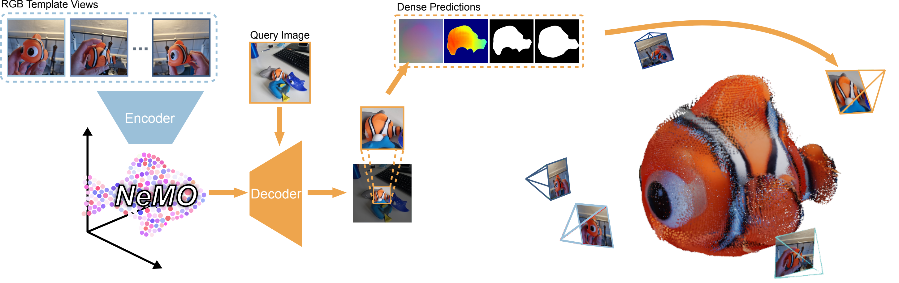
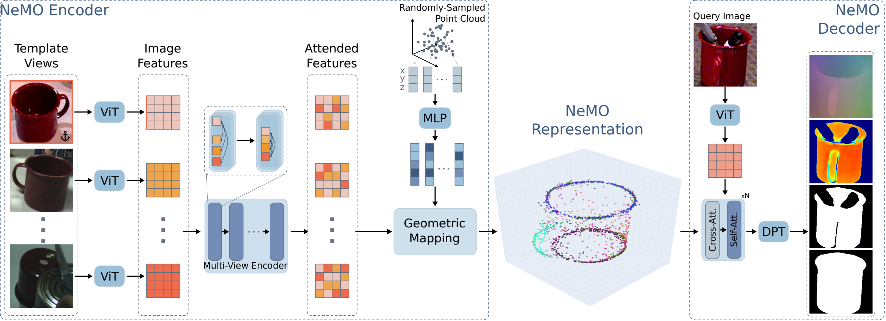
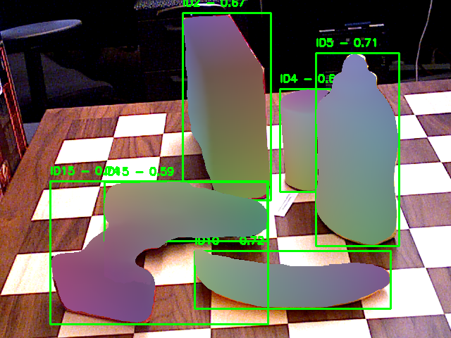
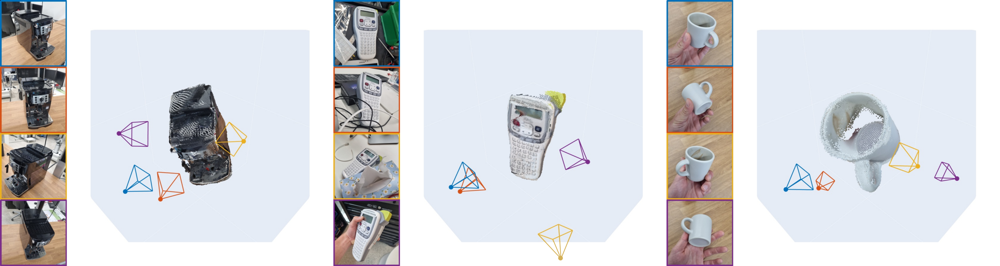
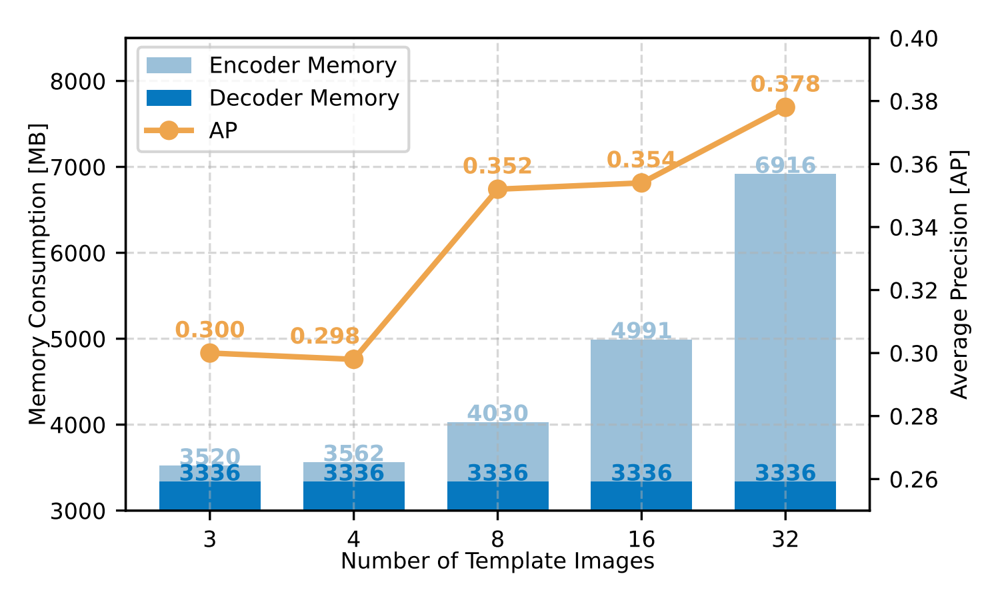
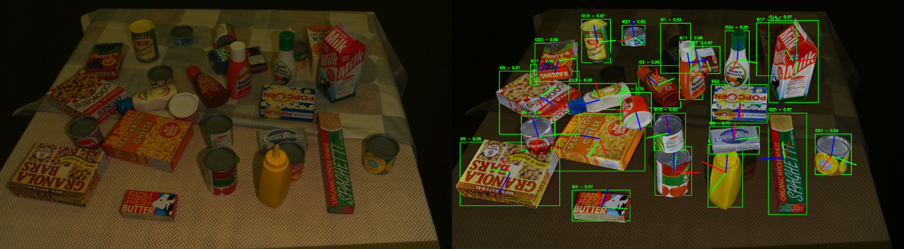
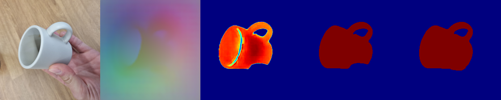
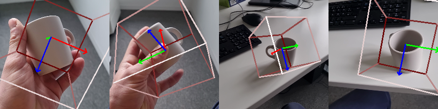
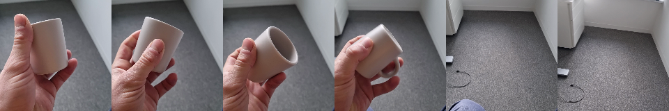
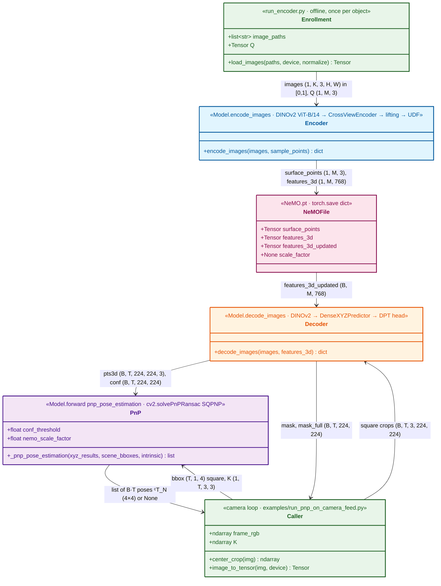

# Finding NeMO: A Geometry-Aware Representation of Template Views for Few-Shot Perception

> arXiv: [2602.04343](https://arxiv.org/abs/2602.04343) · Sebastian J. et al. (DLR) · 3DV 2026 (Oral) · 2026-02-04
> Project: [sebastian-jung.github.io/nemo](https://sebastian-jung.github.io/nemo/) · Code: [DLR-RM/nemo](https://github.com/DLR-RM/nemo) (local: `~/Coding/nemo`)
> Source: [Paper.md](sources/NeMO/Paper.md) · [PDF](sources/NeMO.pdf)

> [!abstract] Overview
> ## TL;DR — A 6-DoF Object Pose "Sensor" Enrolled from a Few Photos

NeMO is one frozen 206 M-parameter network that turns $K\geq2$ **unposed, uncalibrated** RGB photos of a never-seen object into an 8.8 MB <u><strong style="color:#a0399f">Neural Memory Object</strong></u> file: 1500 surface points with 768-d features. For any square RGB crop it then returns modal/amodal masks, a dense pixel→object-coordinate map and its confidence, and PnP-RANSAC on those correspondences gives a 6-DoF object pose. No CAD model, no retraining, no template poses.

Read as a sensor datasheet, the catches are on the output side:

- The pose lives in a frame fixed by the **first template**, at an **arbitrary scale**, so translation is non-metric until a scale is supplied (the code ships `scale_factor = None`).
- PnP needs real intrinsics; every demo hard-codes $f=1000$ px.
- The input must already be an object-centred crop.
- Accuracy is reported only as BOP AP: 0.38 on YCB-V from RGB with GT boxes, 0.48–0.51 with depth ICP. Symmetric/textureless parts fail.

It runs unmodified on an M2 Pro (≈ 10 Hz per object); an RGB-D RealSense fills the intrinsics and scale gaps.

<div align="center"></div>

---

> [!fact] Problem
> ## Model-Free Onboarding of Unseen Objects

The task is <u><strong style="color:#a0399f">unseen-object perception</strong></u>: detect, segment and estimate the 6-DoF pose of an object the network never saw during training, with **no per-object retraining**.
BOP splits it by what the user must supply at test time:

| Setting | Object description given at test time | Template camera poses | Per-object training |
| --- | --- | --- | --- |
| Model-based, seen (classic) | CAD model, also used in training | — | Yes |
| Model-based, unseen | CAD model → rendered templates | Known (rendered) | No |
| **Model-free, unseen** (NeMO's target) | A few real RGB photos | **Unknown** | No |

NeMO's target is the last row, the hardest: no CAD model, no intrinsics, no template poses.
The incumbent model-free pipelines either match query features against every template pairwise, so cost grows with the template count, or reconstruct a neural field from **posed** reference views, as in BundleSDF and FoundationPose, which requires the extrinsics up front.
NeMO's alternative is to compress all templates into one object file offline, so runtime cost is independent of the template count.

Evaluation scope (all BOP test splits, no training on any BOP object):

| Dataset | Setting | Stresses |
| --- | --- | --- |
| T-LESS | Model-based | Textureless, symmetric industrial parts; many same-instance duplicates |
| TUD-L | Model-based | Strong lighting variation, single object |
| YCB-V | Model-based (+ ablations) | Household objects, clutter, occlusion |
| HOPEv2 | Model-free | Grocery-item toys in clutter; RGB-D |
| HANDAL | Model-free | Hand tools; **RGB-only** (no depth) |

---

> [!fact] Sensor Interface
> ## What NeMO Outputs

One frozen network has two entry points.
The **encoder** runs once per object (enrollment) and turns $K\geq2$ unposed RGB templates into a <u><strong style="color:#a0399f">Neural Memory Object</strong></u>: a sparse point cloud on the estimated object surface, with a 768-d feature per point.
The **decoder** runs per frame: NeMO + one square RGB crop → modal/amodal masks, a dense pixel→object-coordinate map, and its confidence.
A 6-DoF pose then comes from classical PnP-RANSAC on those 2D-3D correspondences.
The pose is expressed in a frame **defined by the first template image**, with an **arbitrary scale**; that is the single most important line on this datasheet.

<div align="center"></div>

#### <u>Encoder: Templates → NeMO</u>

$$
\chi=\Psi(\mathcal{I},\mathcal{Q}),\qquad \chi=\left\{\left(s_i,\ \widehat{f}^{\mathcal{Q}}_i\right)\right\}_{i=1}^{M}
$$

$$
s_i=q_i-d_i\,v_i,\qquad d_i=\mathcal{U}\!\left(\widehat{f}^{\mathcal{Q}}_i(q_i)\right),\qquad v_i=\frac{d\,\mathcal{U}\!\left(\widehat{f}^{\mathcal{Q}}_i(q_i)\right)}{d\,q_i}
$$

| $\mathcal{I}=\{I_i\}_{i=1}^{K}$ | $\mathcal{Q}=\{q_i\}_{i=1}^{M}$ | $\Psi$ | $\chi$ | $\widehat{f}^{\mathcal{Q}}_i$ | $\mathcal{U}$ | $d_i,\ v_i$ | $s_i$ |
| --- | --- | --- | --- | --- | --- | --- | --- |
| RGB templates, $K\geq2$, no intrinsics/poses | Query points sampled in $[-1,1]^3$ (random, or on a CAD surface) | Encoder (DINOv2 + multi-view encoder + geometric mapping) | The NeMO | Point feature after attending to all template features | Learned unsigned distance field (MLP) | Distance and (normalized) gradient direction | Estimated surface point |

The stored decoder input adds the surface position back into the feature, $\widetilde{f}^{\mathcal{Q}}_i=\widehat{f}^{\mathcal{Q}}_i+\lambda(s_i)$ — in code `features_3d_updated = features_3d + point_encoder(surface_points)`.

#### <u>Decoder: NeMO + Query → Dense Maps</u>

$$
\Theta(\chi,\ I_q)=\left(P_{\text{modal}},\ P_{\text{amodal}},\ X,\ C\right)
$$

| $I_q$ | $\Theta$ | $P_{\text{modal}}$ | $P_{\text{amodal}}$ | $X\in\mathbb{R}^{H\times W\times3}$ | $C\in\mathbb{R}^{H\times W}$ |
| --- | --- | --- | --- | --- | --- |
| Query image crop, $224\times224$ | Decoder (cross/self-attention to $\chi$ + multi-head DPT) | Visible-object mask | Full-extent mask incl. occluded parts | Per-pixel 3D point in the NeMO frame | Learned confidence of $X$ |

<div align="center"></div>

#### <u>Pose: Dense Correspondences → PnP</u>

Pixels with confidence above a threshold become 2D-3D pairs $(u_i, X_i)$; OpenCV `solvePnPRansac` then recovers the NeMO→camera transform:

$$
{}^{C}\mathbf{T}_{N}=\arg\min_{\mathbf{T}\in SE(3)}\ \sum_{i\in\text{inliers}}\left\lVert u_i-\pi\!\left(K,\ \mathbf{T}\,\sigma X_i\right)\right\rVert
$$

| ${}^{C}\mathbf{T}_{N}$ | $u_i$ | $X_i$ | $\sigma$ | $K$ | $\pi$ |
| --- | --- | --- | --- | --- | --- |
| Pose of the NeMO frame in the camera frame | Pixel (full-image coords, rescaled to the crop) | Predicted NeMO-frame point | `nemo_scale_factor` (NeMO units → metres) | Query-camera intrinsics, scaled to the crop | Pinhole projection |

Paper settings: confidence $>0.1$, 500 RANSAC iterations, 6 px reprojection threshold, $\geq30\%$ inliers.
Code: `cv2.SOLVEPNP_SQPNP` inside RANSAC; at least $16\times16=256$ valid pixels are required, otherwise the pose is `None`.

#### <u>The NeMO Coordinate Frame</u>

Set during training (Supp. *Initial NeMO Space*) and inherited at inference:

| Property | Definition | Consequence |
| --- | --- | --- |
| Origin | Mean of the anchor view's surface points | Origin sits near the centroid of the **visible** side in the anchor, not the true centroid |
| Orientation | Anchor image's camera frame, OpenCV convention ($x$ right, $y$ down, $z$ forward) | Object axes depend on how the first photo was taken |
| Scale | Anchor surface points occupy $1/3$ of $[-1,1]^3$ (measured: ≈ 0.7 units per axis) | Dimensionless; translation is **not metric** until $\sigma$ is set |
| Anchor | `images[:, 0]` in [`encoder.py:38`](https://github.com/DLR-RM/nemo/blob/7647881/src/nemolib/modules/encoder.py#L38) — the first file in the sorted glob | Changing the template set or order changes the frame |

For BOP scoring only, the authors fit scale, rotation and centre offset against **ground-truth** poses of the $k=5$ best template predictions (Adam + Huber loss, Supp. Alg. 1).
No such alignment exists at deployment time.

#### <u>Output Datasheet</u>

| Output | Key in code | Shape (per query) | Frame / range |
| --- | --- | --- | --- |
| Modal mask $P_{\text{modal}}$ | `mask` | $224\times224$ | Sigmoid probability |
| Amodal mask $P_{\text{amodal}}$ | `mask_full` | $224\times224$ | Sigmoid probability |
| Pointmap $X$ | `pts3d` | $224\times224\times3$ | NeMO units; tanh-bounded to $[-1,1]^3$ |
| Confidence $C$ | `conf` | $224\times224$ | $\exp(x)\in[0,\infty)$; ≈ 1.2–2.0 on the object, ≈ 0 off it |
| Scaled depth + its confidence | `depth_scaled`, `depth_scaled_conf` | $224\times224$ | Not described in the paper; softplus clamped to $[0,3]$ |
| 6-DoF pose | return of `"pnp_pose_estimation"` | $4\times4$ or `None` | ${}^{C}\mathbf{T}_{N}$, translation in NeMO units $\times\sigma$ |
| Amodal 2D boxes | `examples/run_detection_on_video.py` | List of $(x_0,y_0,x_1,y_1)$ + mean mask score | Full-image pixels |
| Surface reconstruction | `surface_points`, or confident `pts3d` over templates | $M\times3$ / $N\times3$ | NeMO units |

---

> [!fact] Setup
> ## Enrollment and Runtime Prerequisites

#### <u>Enrollment (Offline, Once per Object)</u>

| Requirement | Specification |
| --- | --- |
| Template images | $K\geq2$ RGB; acceptable from $K=3$, benchmarks use $K=32$ |
| Camera | Any; **no intrinsics, no poses, unordered**. Paper teaser and in-the-wild demos use a smartphone |
| Framing | Object-centric: code center-crops to a square and resizes to $224\times224$, so the object should fill the middle of the frame |
| Capture scenarios shown | Static object + moving camera; object in different scenes with occlusion; object rotated **in hand** in front of a static camera |
| Anchor | First template (sorted filename) fixes the object frame — choose it deliberately |
| Query points $\mathcal{Q}$ | 1500 uniform in $[-1,1]^3$ by default; can be sampled on a CAD surface if one exists |
| Encoder memory | 3520 MB at $K=3$ → 6916 MB at $K=32$ (A100) |
| Artifact | One `NeMO.pt` dict; reusable indefinitely, the network is never fine-tuned |

<div align="center"></div>

Template count versus accuracy and memory (YCB-V 6D pose, GT detections, no refinement):

<div align="center"></div>

| Templates $K$ | 3 | 4 | 8 | 16 | 32 |
| --- | --- | --- | --- | --- | --- |
| AP | 0.300 | 0.298 | 0.352 | 0.354 | 0.378 |
| Encoder memory (MB) | 3520 | 3562 | 4030 | 4991 | 6916 |
| Decoder memory (MB) | 3336 | 3336 | 3336 | 3336 | 3336 |

NeMO size $M$ trades accuracy for decoder cost; the model was trained only at $M=1500$:

| NeMO points $M$ | 10 | 50 | 100 | 200 | 500 | 1000 | 1500 |
| --- | --- | --- | --- | --- | --- | --- | --- |
| AP | 0.004 | 0.112 | 0.214 | 0.290 | 0.380 | 0.383 | 0.378 |
| Time / image (s, A100) | 0.402 | 0.671 | 0.460 | 0.393 | 0.340 | 0.320 | 0.336 |

Two NeMOs of the same object that share an anchor image can be concatenated point-wise. On YCB-V, a fused pair of 4-image NeMOs reaches Chamfer 0.0080, against 0.0081 for one NeMO built from all 7 views.

#### <u>Runtime (Per Frame)</u>

| Input | Needed for | Provided by the code? |
| --- | --- | --- |
| Square RGB crop around the object | Decoder (trained on jittered object-box crops plus pure-background negatives: 30 % per the paper, 50 % in the shipped config) | Only full-frame center-crop, or a slow sliding-window detector |
| Real intrinsics $K$ | Correct rotation and depth from PnP | API accepts $K$ + box; every example passes a fake $f=1000$ px |
| Scale $\sigma$ | Metric translation | `scale_factor` key is saved as `None`; nothing computes it |
| Depth (optional) | ICP refinement, metric scale | No ICP or depth code in the repo |
| CAD (optional) | Surface-sampled $\mathcal{Q}$, CAD-ICP | Not in the repo |

Paper latency (A100, pose pipeline with GT boxes): 0.32–0.34 s per image without ICP, 1.5–2.0 s with ICP.
Detection uses sliding windows: the image is patchified at 2 sizes (paper) or 3 sizes (code) with stride $1/3$ of the patch, every patch is decoded, and the amodal masks are clustered into boxes.

---

> [!hint] Accuracy
> ## Benchmarks Translated to Sensor Terms

**No metric error statistics (mm, degrees) are reported anywhere.**
All pose numbers are BOP AP/AR, averaged over tolerance sweeps (BOP 2020 §2.2):

- MSSD (3D surface deviation): threshold swept $5\%\to50\%$ of the object diameter in $5\%$ steps.
  For an object 10 cm in diameter, that is 5 mm → 50 mm.
- MSPD (2D projection deviation): threshold swept $5r\to50r$ px, $r=w/640$.
- 6D detection **AP** = mean of $\text{AP}_{\text{MSSD}}$ and $\text{AP}_{\text{MSPD}}$; 6D localization **AR** additionally averages in VSD.

An AP of $0.38$ therefore mixes coarse and fine tolerances; it cannot be inverted into an error bound.

#### <u>Cleanest Sensor Number: YCB-V, Ground-Truth Boxes</u>

GT detections isolate the pose stage from the detector (ablation decoder that outputs only pointmap + confidence, real templates):

| ICP source | Point sampling $\mathcal{Q}$ | AP | AP$_{\text{MSPD}}$ | AP$_{\text{MSSD}}$ | s / image |
| --- | --- | --- | --- | --- | --- |
| None (RGB only) | Random | 0.378 | 0.370 | 0.385 | 0.336 |
| None (RGB only) | CAD surface | 0.383 | 0.420 | 0.347 | 0.531 |
| Pointmap surface (needs depth) | Random | 0.475 | 0.394 | 0.557 | 1.720 |
| Pointmap surface (needs depth) | CAD surface | 0.507 | 0.447 | 0.567 | 1.479 |
| CAD (needs depth + CAD) | Random | 0.671 | 0.639 | 0.703 | 2.049 |
| CAD (needs depth + CAD) | CAD surface | 0.626 | 0.594 | 0.658 | 1.607 |

Depth mostly buys 3D accuracy: AP$_{\text{MSSD}}$ goes from 0.385 to 0.557, while AP$_{\text{MSPD}}$ barely moves (0.370 → 0.394).
That is the expected signature of RGB-only PnP, whose error concentrates in depth along the optical axis.

#### <u>Model-Free (No CAD) — the Target Use Case</u>

| Task (AP) | Detections | HOPEv2 | HANDAL |
| --- | --- | --- | --- |
| 2D detection | NeMO | **0.411** (SOTA, +2.7 pp) | **0.273** (SOTA, +0.9 pp; the text claims 1.9) |
| 6D detection | CNOS | 0.307 | — |
| 6D detection | GFreeDet-FastSAM | 0.329 | 0.213 |
| 6D detection | NeMO | 0.302 | **0.235** |
| 6D detection, OPFormer (unpublished) | CNOS | **0.335** | 0.204 |

HOPEv2 pose uses ICP between the NeMO surface and the scene depth (RGB-D); HANDAL is pure RGB.
Better NeMO detections (higher 2D AP) do not translate into better pose AP: the authors attribute this to amodal boxes, which score well as detections but are worse crops for pose.

#### <u>Model-Based (CAD Given) — Off-Design, for Scale</u>

6D localization AR **without** refinement (default CNOS detections unless noted):

| Method | T-LESS | TUD-L | YCB-V |
| --- | --- | --- | --- |
| NeMO, GT boxes | 0.295 | 0.538 | 0.566 |
| NeMO, NeMO boxes | 0.082 | 0.466 | 0.493 |
| NeMO, CNOS | 0.190 | 0.476 | 0.504 |
| MegaPose | 0.177 | 0.258 | 0.281 |
| GigaPose | 0.264 | 0.300 | 0.278 |
| FoundPose | 0.338 | 0.469 | 0.452 |
| Co-op | **0.592** | **0.642** | **0.626** |

6D detection AP **with** refinement — NeMO uses a plain ICP; the leaders use RGB-D refiners:

| Method | T-LESS | TUD-L | YCB-V |
| --- | --- | --- | --- |
| NeMO (CNOS boxes) + ICP | 0.291 | 0.560 | 0.592 |
| NeMO (NeMO boxes) + ICP | 0.144 | 0.756 | 0.567 |
| Co-op (coarse, RGB-D) | 0.620 | 0.841 | 0.808 |
| FreeZeV2.2 | 0.777 | 0.988 | 0.911 |
| FRTPose-WAPP | **0.826** | 0.978 | **0.918** |

Detection / segmentation AP (model-based): TUD-L 0.623 is SOTA (+3 pp); YCB-V 0.602 ranks 6th of 13; T-LESS 0.183 is near last. Segmentation AP is 0.169 / 0.488 / 0.579, below SAM-based methods, which the authors attribute to patch-border artifacts.

<div align="center"></div>

#### <u>Failure Modes and Limitations</u>

*Authors acknowledge:*
- **Symmetric objects.** The encoder regresses a unique surface point, so symmetry breaks it (T-LESS).
- **Textureless objects.** Underrepresented in the synthetic training set.
- **Multiple instances.** Boxes come from amodal-mask clustering, so touching duplicates merge into one box.

*Perceived:*
- **GT-fitted frame inflates benchmark translation.** Scale, rotation and centre offset are fitted against GT poses before scoring, so the benchmark numbers assume a perfectly calibrated $\sigma$ and object frame. A deployment has to estimate $\sigma$ itself.
- **The "model-free pose SOTA" on HOPEv2 is RGB-D** (ICP on scene depth), not RGB-only.
- **Far behind CAD-based RGB-D refiners** (0.59 vs 0.91 AP on YCB-V). NeMO's niche is onboarding speed without CAD, not peak accuracy.
- **Unreleased artifacts.** The 11 077-object synthetic dataset is listed as a contribution, but neither it nor the training/eval code is in the repo, so no number is reproducible from the release.
- **Per-frame and stateless.** There is no tracking or temporal filtering; every frame is an independent PnP-RANSAC.

---

> [!fact] Reflection
> ## My Read

<!-- Left for the user. -->

---

> [!hint] Codebase
> ## Codebase Status and Structure

**Verdict:** [`DLR-RM/nemo`](https://github.com/DLR-RM/nemo) is a small, clean, **inference-only** package (`nemolib`, ~5.3 k lines including examples) plus one 824 MB checkpoint. It runs on an M2 Pro via MPS with no code changes. Everything a pose *sensor* needs beyond "pointmap + PnP on a center crop" is left to the user: real intrinsics, metric scale, detection-to-crop plumbing, ICP, and frame alignment.

| Aspect | Assessment |
| --- | --- |
| **Completeness** | Encoder, decoder, PnP and 12 demo scripts only; no training code, no dataset, no BOP evaluation, no ICP, no NeMO-frame alignment. |
| **Adaptation** | README plus self-explanatory example scripts; 43 stars, 1 fork, one external PR (Apple MPS support), no issues, so few real users yet. |
| **Dependency** | Plain PyTorch + OpenCV, but DINOv2 is fetched at runtime through `torch.hub` and static plots need a downloaded Chrome (kaleido). |
| **Currency** | torch 2.8 / Python ≥ 3.9, 7 commits, last on 2026-07-21 (the MPS fix). |

**License caveat.** The repo is labelled MIT, but the five DUSt3R-derived files in `src/nemolib/modules/heads/` carry Naver's **CC BY-NC-SA 4.0 (non-commercial)** header. The pointmap head everything depends on is therefore not MIT.

**Paper↔code mismatches.**
- *PnP settings:* the paper says 500 iterations, 6 px, ≥ 30 % inliers, conf > 0.1. The library defaults are `SOLVEPNP_SQPNP`, 100 000 iterations, 5 px, 0 % inliers; the examples use 500–1000 iterations, 2–6 px, **conf > 1.2**.
- *Detection:* the paper uses 2 patch sizes; `run_detection_on_video.py` uses 3 (full, ½, ⅓ of the short side).
- *Training negatives:* the paper says 30 % random crops; the shipped config has `false_bbox_chance: 0.5`.
- *Undocumented outputs:* the decoder also emits `depth_scaled` / `depth_scaled_conf` (8 output channels); the paper describes 4 outputs.
- *Metric scale:* `save_nemo` asserts a `scale_factor` key exists, yet every script writes `None` and nothing ever reads it.

**Code hazards.**
- `from_checkpoint` loads with `strict=False` ([`model.py:141`](https://github.com/DLR-RM/nemo/blob/7647881/src/nemolib/model.py#L141)), so a mismatched checkpoint loads silently.
- `decode_images` center-crops any non-square input ([`model.py:106`](https://github.com/DLR-RM/nemo/blob/7647881/src/nemolib/model.py#L106)), so a rectangular box silently loses its sides.
- The `decode_images` docstring is copy-pasted from `encode_images`.
- `segment_objects` decodes every patch of a scale in **one batch** ([`run_detection_on_video.py:63`](https://github.com/DLR-RM/nemo/blob/7647881/examples/run_detection_on_video.py#L63)).

**Replication difficulty: Easy** for inference — `pip install .`, `cat checkpoints/part_* > checkpoints/checkpoint.pth`, run an example. **Paper numbers: not reproducible**, since none of the evaluation, training code or data is released. **Adapting the key technique: Easy** as a black-box library (three calls); the frame/scale/crop plumbing below is yours to write. Retraining or modifying the network is impractical (16 A100 × 10 days, unreleased data).

### Run Log — MacBook Pro M2 Pro (16 GB, MPS, torch 2.8.0)

Setup used (`~/Coding/nemo`, commit `7647881`):

```bash
git clone --depth 1 --filter=blob:limit=5m --no-checkout \
    https://github.com/DLR-RM/nemo.git && cd nemo
git sparse-checkout set --no-cone '/*' \
    '!/checkpoints/part_*' '!/assets/*/video.mp4'
git checkout main && mkdir -p checkpoints
# resumable shard download; verify each file's `git hash-object`
# against the blob id from `git ls-tree HEAD checkpoints/`
for p in $(git ls-tree --name-only HEAD checkpoints/); do
  curl -L -C - --retry 5 -o "$p" \
    "https://raw.githubusercontent.com/DLR-RM/nemo/main/$p"
done
cat checkpoints/part_* > checkpoints/checkpoint.pth
uv venv --python 3.12 .venv
uv pip install torch==2.8.0 torchvision==0.23.0 -e .
.venv/bin/plotly_get_chrome   # PCA / point-cloud PNGs only
```

| Step | Result |
| --- | --- |
| Plain `git clone` | Failed twice with `early EOF`: the 830 MB pack carries the checkpoint as 16 × 50 MB git blobs. The partial clone + per-shard `curl` above worked |
| First model construction | `torch.hub` downloads the DINOv2 repo zip and the 346 MB ViT-B/14 weights, then overwrites them from the checkpoint, so internet is needed once |
| `run_encoder.py` (mug, $K=4$) | Works: 38.7 s wall including downloads, 4.97 GB peak footprint, `NeMO.pt` = 8.8 MB |
| `run_decoder_on_image.py` | Crashes on its default `--image-path` (`assets/query_image.jpg` does not exist); works with an explicit path |
| `nemo_demo.py`, `run_*_camera_feed.py` | Not run (interactive webcam windows + keypresses); the identical encode → decode → PnP path was exercised offline on `assets/mug/video.mp4` |
| Encode latency | $K$ = 2 / 4 / 8 / 16 → 0.19 / 0.26 / 0.41 / 0.77 s |
| Decode latency | 90 ms (batch 1), 59 ms/img (batch 4), 52 ms/img (batch 16); CPU only: 213 ms |
| PnP (SQPNP, 500 iterations) | 12 ms |
| Sliding-window detection | 1440 × 1440 frame, 66 patches: 4.3 s steady state. 1280 × 720, 138 patches: 92–256 s, exhausting the 16 GB unified memory and swapping |

<div align="center"></div>

Sensor behaviour measured on the shipped mug assets (Samsung S21 photos and video; the EXIF 26 mm-equivalent lens gives $f\approx224$ px at the 224 px model input):

| Measurement | Result |
| --- | --- |
| Model | 206 M parameters fp32, of which 86.6 M is the DINOv2 ViT-B/14 backbone (fine-tuned, `backbone_fix: false`) |
| Output ranges | `conf` $=\exp(x)\in[0, 2.06]$: ≈ 1.2–2.0 on the object, ≈ 0 on background. `pts3d` is tanh-bounded; observed $[-0.47, 0.54]$ |
| NeMO extent | Surface points span 0.71 × 0.61 × 0.71 units, i.e. ≈ ⅓ of the $[-1,1]$ cube per axis, as specified |
| Anchor check | Template 0's pose is 6.7° from identity; by definition it should be 0° |
| Fake vs EXIF intrinsics | $f=1000$ instead of 224 px inflates $t_z$ 4.4× and shifts rotation 4.5° median / 9.7° p90 |
| Re-encode, new random $\mathcal{Q}$ | Frame moves 0.8° (median); per-frame poses disagree by 4.6° (median) |
| Re-encode, anchor swapped | Frame rotates 86° (the angle between the two anchor views) |
| Pose availability, 193 video frames | 62 % at conf > 1.2 (demo default), 82 % at conf > 0.1 (paper) |
| Rotation step between samples 67 ms apart | 4.0° median / 10.4° p90 — an upper bound on jitter, since the handheld video also moves |

<div align="center"></div>

Where the pose drops out at conf > 1.2: views where the handle is hidden (the mug becomes rotationally symmetric), and frames without the mug.
On empty frames, confidence and masks go to ≈ 0, so the sensor abstains rather than hallucinating.

<div align="center"></div>

### Pipeline Breakdown

Three boundaries matter: templates → NeMO file (offline), crop + NeMO → dense maps, and dense maps + box + $K$ → pose.
The caller owns everything outside `nemolib`: cropping, intrinsics, scale, and turning ${}^{C}\mathbf{T}_{N}$ into a robot-frame target.

#### Data Flow Diagram

<!-- TODO: Convert the Mermaid below to Excalidraw and embed as ![[NeMO DataFlow|100%]] -->



#### Layer-Boundary API Signatures

**1. Enrollment → Encoder.** ([`model.py:145`](https://github.com/DLR-RM/nemo/blob/7647881/src/nemolib/model.py#L145))

```python
def encode_images(self,
                  images: Tensor | np.ndarray,
                  sample_points: Tensor | int = 1000
                  ) -> dict[str, Tensor]:
    '''
    Encode images into a neural object model.
    images:        (b, t, 3, H, W) RGB in [0, 1], t = K templates;
                   images[:, 0] is the anchor (defines the frame)
    sample_points: int -> uniform in [-1, 1]^3, or (b, M, 3)
    returns: surface_points (b, M, 3), features_3d (b, M, 768),
             distances (b, M, 1), gradients (b, M, 3),
             sample_points (b, M, 3)
    The caller must add features_3d_updated = features_3d
    + model.point_encoder(surface_points) and a scale_factor
    key before save_nemo().
    '''
    ...
```

**2. NeMO file.** ([`utils.py:349`](https://github.com/DLR-RM/nemo/blob/7647881/src/nemolib/utils.py#L349))

```python
def save_nemo(nemo_data: dict[str, Any], out_path: str) -> None:
    '''
    torch.save after asserting keys features_3d_updated and
    scale_factor exist. Only features_3d_updated (1, 1500, 768)
    is read at runtime; the stored file is 8.8 MB.
    '''
    ...
```

**3. Crop + NeMO → dense maps.** ([`model.py:199`](https://github.com/DLR-RM/nemo/blob/7647881/src/nemolib/model.py#L199))

```python
def decode_images(self,
                  images: Tensor | np.ndarray,
                  features_3d: Tensor) -> dict[str, Tensor]:
    '''
    (Shipped docstring is a copy of encode_images'.)
    images:      (b, t, 3, H, W) RGB in [0, 1]; resized to 224 on
                 the short side, then CENTER-CROPPED to 224 x 224
    features_3d: (b, M, 768) = nemo["features_3d_updated"]
    returns:
      pts3d               (b, t, 224, 224, 3) NeMO frame, tanh
      conf                (b, t, 224, 224)    exp(x) >= 0
      mask, mask_full     (b, t, 224, 224)    sigmoid
      depth_scaled(_conf) (b, t, 224, 224)    undocumented
    '''
    ...
```

**4. Dense maps + box + $K$ → pose.** Called as `model.forward("pnp_pose_estimation", ...)`. ([`model.py:300`](https://github.com/DLR-RM/nemo/blob/7647881/src/nemolib/model.py#L300))

```python
def _pnp_pose_estimation(self,
                         xyz_results: dict[str, Tensor],
                         scene_bboxes: Tensor,
                         intrinsic: np.ndarray,
                         conf_threshold: float = 0.1,
                         nemo_scale_factor: float = 1.0,
                         **ransac_kwargs: Any
                         ) -> list[np.ndarray | None]:
    '''
    xyz_results:  decoder output (pts3d, conf are used)
    scene_bboxes: (t, 1, 4) SQUARE boxes (x0, y0, x1, y1) in
                  full-image pixels that the crops came from
    intrinsic:    (b, t, 3, 3) full-image K; rescaled internally
                  by 224 / box_size, so crops keep true geometry
    ransac_kwargs: confidence, iterationsCount (default 1e5),
                  reprojectionError (5 px), min_inlier_ratio (0)
    returns: b*t entries of 4x4 cT_N (NeMO -> camera), with
             translation in NeMO units * nemo_scale_factor;
             None if < 256 px pass conf_threshold or RANSAC
             fails
    '''
    ...
```

**5. Detection (example-only, not in the library).** ([`run_detection_on_video.py:18`](https://github.com/DLR-RM/nemo/blob/7647881/examples/run_detection_on_video.py#L18))

```python
def segment_objects(model: Model,
                    features: Tensor,
                    image: Tensor,
                    mask_thr: float = 0.5,
                    patch_size: int = 128,
                    stride: int = 64,
                    device: torch.device | None = None
                    ) -> tuple[Tensor, Tensor, Tensor, Tensor]:
    '''
    Segment objects by sliding a patch-based predictor over the
    image. image: (3, H, W); features: (B, M, 768).
    returns amodal_mask, amodal_confidence, modal_mask,
    modal_confidence, each (B, 1, H, W). The caller averages 3
    patch scales and boxes connected components of the amodal
    mask (masks_to_bounding_boxes, min area 32 x 32).
    '''
    ...
```

---

> [!example] Integration
> ## Feasibility with an Intel RealSense RGB-D Camera

**Verdict: feasible, and a better host than the phone or webcam the demos assume.** A RealSense D4xx supplies exactly the two inputs NeMO lacks: factory-calibrated intrinsics and metric depth. Expect roughly 200 lines of glue, not a drop-in. The real blockers are the crop/detector and symmetric objects, not the camera.

#### <u>Gap-by-Gap Mapping</u>

| NeMO gap | What the RealSense provides | Remaining work |
| --- | --- | --- |
| Fake $f=1000$ intrinsics | Factory color intrinsics via `rs.video_stream_profile.get_intrinsics()` → `fx, fy, ppx, ppy` | Pass the full-image $K$ plus the square box to `_pnp_pose_estimation`; it rescales $K$ itself |
| Non-metric translation ($\sigma$ unset) | Depth aligned to color (`rs.align(rs.stream.color)`) | Fit $\sigma$ once at enrollment (Sim(3), below) and store it in `nemo["scale_factor"]` |
| Depth-axis error of RGB-only PnP | Per-pixel metric points $P_i$ | Replace PnP with SE(3) on $(\sigma X_i, P_i)$, then optional ICP |
| Object-centred square crop | — | Supply boxes from another detector; the shipped sliding-window detector is unusable at 1280 × 720 |
| Enrollment photos | Color frames of the same camera, or phone photos (no $K$ needed) | Choose the anchor view deliberately |
| Robot-frame pose | — | Hand-eye calibrate ${}^{B}\mathbf{T}_{C}$ (e.g. a ChArUco board) |

#### <u>Metric Scale from Depth</u>

With confident, valid-depth object pixels $i$ (modal mask ∧ `conf` > thr ∧ $D(u_i)>0$), back-project and solve a similarity transform (Umeyama, inside RANSAC):

$$
P_i=D(u_i)\,K^{-1}\begin{bmatrix}u_i\\1\end{bmatrix}
$$

$$
\left(\sigma^{*},R^{*},t^{*}\right)=\arg\min_{\sigma,R,t}\ \sum_i\left\lVert P_i-\left(\sigma R X_i+t\right)\right\rVert^{2}
$$

| $u_i$ | $D(u_i)$ | $K$ | $P_i$ | $X_i$ | $\sigma$ | $R, t$ |
| --- | --- | --- | --- | --- | --- | --- |
| Full-image pixel of crop pixel $i$ ($u = x_0 + x_c\,s^{-1}$, $s = 224/\text{box}$) | Aligned depth in metres | RealSense color intrinsics | Metric camera-frame point | Decoded NeMO-frame point | Metres per NeMO unit — constant per NeMO file | Rigid pose ${}^{C}\mathbf{T}_{N}$ |

Fit $\sigma$ once, as the median over several enrollment frames, and freeze it.
At runtime, either run RGB-only PnP with `nemo_scale_factor` $=\sigma$ (metric, but with RGB-only depth error), or solve SE(3) on $(\sigma X_i, P_i)$ with $\sigma$ fixed and then ICP.
The latter is the paper's "pointmap surface + ICP" regime: YCB-V AP $0.378\to0.475$–$0.507$, with AP$_{\text{MSSD}}$ $0.385\to0.557$.

```python
def enroll(colors: list[np.ndarray],
           depths: list[np.ndarray],
           K: np.ndarray,
           boxes: list[tuple[int, int, int, int]]) -> dict:
    '''
    colors[0] is the anchor: take it from the camera pose the
    robot will usually see the object from, so NeMO axes are
    near camera axes there (measured: 6.7 deg off identity).
    1. Square-crop 8-16 views -> encode_images -> NeMO.
    2. Decode the enrollment crops; per frame, Umeyama-RANSAC
       on (X_i, P_i) -> sigma_f; sigma = median(sigma_f).
    3. nemo["scale_factor"] = sigma; save once. Re-encoding
       moves the frame (0.8 deg for new Q, ~86 deg for a new
       anchor), invalidating every stored grasp offset.
    '''
    ...


def measure(color: np.ndarray, depth: np.ndarray,
            K: np.ndarray, nemo: dict,
            box: tuple[int, int, int, int]
            ) -> np.ndarray | None:
    '''
    box comes from an external detector, or from re-projecting
    the previous pose (tracking-style crop).
    1. Square crop -> 224 -> decode_images.
    2. Mask: modal > 0.5, conf > 1.2, depth valid, eroded at
       the silhouette (mixed depth pixels).
    3. Kabsch-RANSAC on (sigma * X_i, P_i) -> cT_N in metres;
       if too few depth pixels, fall back to PnP with the
       box-scaled K and nemo_scale_factor = sigma.
    4. Optional ICP: sigma * X (or NeMO surface) -> depth cloud.
    returns cT_N (4x4, metres) or None (abstain).
    '''
    ...
```

#### <u>Expected Performance</u>

| Item | Expectation | Basis |
| --- | --- | --- |
| Rate (one object) | ≈ 10 Hz on the M2 Pro (90 ms decode + 12 ms PnP); a discrete NVIDIA GPU was not measured | Run log above |
| GPU memory | Decoder 3.3 GB; encoder 4.0 GB at $K=8$, 5.0 GB at $K=16$, 6.9 GB at $K=32$ | Paper (A100) |
| Fit on the Linux laptop's 8 GB RTX 5060 | Runtime fits; enroll with $K\leq16$, or encode on the Mac and copy `NeMO.pt` | Above |
| Accuracy class | Between the paper's RGB-only and pointmap-ICP rows; no mm/deg numbers exist | Accuracy section |
| Abstention | Empty / occluded / handle-hidden views return `None` rather than a wrong pose (at conf > 1.2) | Run log above |

#### <u>Practical Issues</u>

- **Host OS.** Official `pyrealsense2` wheels (2.58) exist for Linux x86_64/aarch64 and Windows only. macOS has only the community `pyrealsense2-macosx` (2.56.5, macOS 15 arm64), and librealsense on macOS commonly needs root for USB. Run the camera on the Linux machine.
- **Symmetric and textureless objects.** RPent's own example target, `YELLOW_PLATE`, is the worst case: a plate is rotationally symmetric and nearly textureless, exactly where NeMO fails (T-LESS) or abstains (handle-hidden mug). Yaw about the symmetry axis is unobservable, so a stored $T^{\text{OBJ}}_{\text{EF}}$ must be symmetry-invariant (top-down grasp) or re-resolved per grasp.
- **Scale is mandatory for the RPent scheme.** $T^{\text{OBJ}}_{\text{EF}}=(T^{\text{world}}_{\text{OBJ}})^{-1}T^{\text{world}}_{\text{EF}}$ (see [[RPent Literature Review]]) assumes a rigid, metric ${}^{C}\mathbf{T}_{N}$. With $\sigma$ unset, the translation lives in NeMO units and the composition is wrong.
- **Detection budget.** At 1280 × 720 the shipped detector decodes 138 patches, all patches of a scale in one batch: 92–256 s per frame on the M2 Pro. Feed boxes from the planner's segmentation or another detector, and keep NeMO for pose only.
- **Depth artifacts.** Shiny, dark or transparent surfaces leave holes, and silhouettes produce mixed pixels. Gate on the modal mask, erode it, and keep the PnP fallback.
- **Rolling-shutter RGB vs global-shutter depth** (D435): misaligned under motion, so measure when the scene is static (e.g. before a grasp, not during transport).
